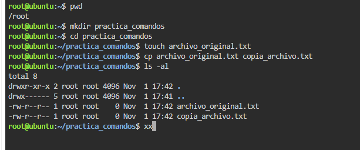
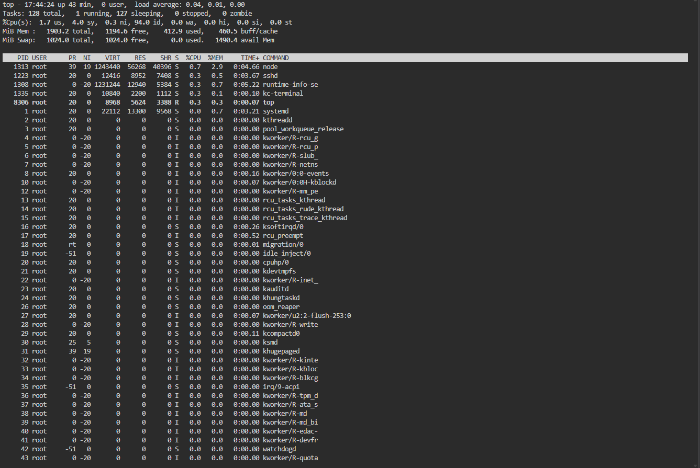
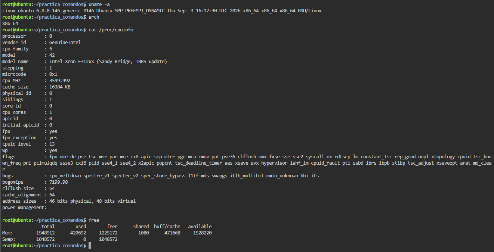
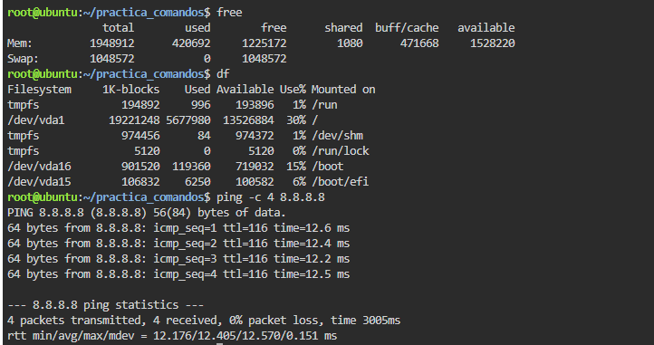

# TP: Comandos Básicos, Procesos y Utilidades en Linux

* **Materia:** Mantenimiento de Software
* **Estudiante:** Franco Lautaro Alvarez
* **Fecha de Entrega:** 2026
* **Profesor:** Artaza

---

## 1. Gestión de Archivos y Directorios

* **Explicación de `ls -al`:**  
El comando `ls` simple lista únicamente los nombres de los archivos y directorios visibles (no ocultos) de manera resumida. Al agregar los modificadores `-al`, se combinan dos funcionalidades esenciales:
  * `-a` (*all*): muestra **todos** los elementos, incluyendo los archivos y directorios ocultos (aquellos cuyo nombre comienza con un punto `.`).
  * `-l` (*long format*): presenta la información en formato de lista detallada, mostrando permisos de acceso, número de enlaces, usuario propietario, grupo al que pertenece, tamaño en bytes y fecha/hora de la última modificación.

---

## 2. Monitoreo de Procesos

* **Diferencia entre `ps` y `top`:**  
El comando `ps` (ejecutado sin opciones) toma una "captura estática" o instantánea únicamente de los procesos activos inicializados por el propio usuario en la sesión de terminal actual. En cambio, `top` es una herramienta dinámica e interactiva que muestra en tiempo real la totalidad de los procesos que se están ejecutando en el sistema, actualizando periódicamente la pantalla y ordenándolos según el consumo de recursos (CPU y memoria RAM).
* **Uso de `kill`:**  
El comando `kill pid` se utiliza para enviar señales del sistema (por defecto de terminación) a un proceso específico identificado por su número de PID (*Process Identifier*). Cuando un programa queda "colgado" o en estado zombie y no responde a los métodos de cierre normales, `kill` permite forzar su finalización inmediata para liberar recursos y evitar la degradación del sistema.

---

## 3. Información del Sistema

* **Detalles del Kernel y Memoria:**  
  * **`uname -a`:** Aporta información detallada y completa sobre el núcleo (kernel) del sistema operativo. Muestra el nombre del kernel (Linux), el nombre de red del equipo (*hostname*), la versión de release y fecha de compilación del kernel, la arquitectura del procesador y el sistema operativo.
  * **`free`:** Muestra el estado y utilización de la memoria del sistema, desglosando la memoria física (RAM) y la memoria de intercambio (*SWAP*) en sus estados: total, utilizada, libre, compartida y disponible.

---

## 4. Red y Espacio en Disco

* **Funcionamiento de `ping`:**  
El comando `ping` es la herramienta estándar para verificar la conectividad y el alcance entre dos equipos en una red bajo el protocolo TCP/IP. Funciona transmitiendo pequeños paquetes de datos (mensajes de solicitud de eco ICMP) a una dirección IP o nombre de host de destino, solicitando su devolución inmediata. Si el destino responde (eco ICMP devuelto), `ping` confirma que la conexión física y lógica es funcional, reportando además la tasa de pérdida de paquetes y la latencia (tiempo de ida y vuelta o *round-trip time*).
