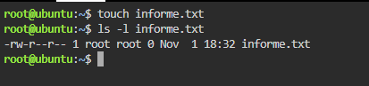
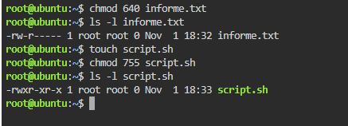
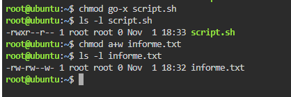
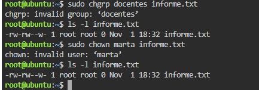
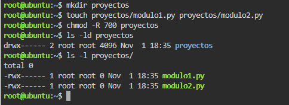

# TP: Permisos de Archivos, Directorios y Propiedad en Linux

* **Materia:** Mantenimiento de Software
* **Estudiante:** Franco Lautaro Alvarez
* **Fecha de Entrega:** 2026
* **Profesor:** Artaza

---

## 1. Lectura e Interpretación de Permisos (`ls -l`)

| Posición | Representación | Significado / Permiso |
| :--- | :--- | :--- |
| Tipo | `-` / `d` / `l` | Indica el tipo de fichero: `-` para un archivo regular (texto, binario, imagen), `d` para un directorio o carpeta, y `l` para un enlace simbólico (*link* o acceso directo). |
| Propietario (`u`) | `rwx` | Permisos asignados al usuario dueño (*user*): `r` (lectura - bit 4), `w` (escritura/modificación - bit 2) y `x` (ejecución - bit 1). Los permisos no otorgados se visualizan con un guion `-`. |
| Grupo (`g`) | `rwx` | Permisos asignados al grupo propietario (*group*): `r` (lectura), `w` (escritura) y `x` (ejecución). Rige para todos los usuarios pertenecientes al grupo del archivo. |
| Otros (`o`) | `rwx` | Permisos asignados al resto de los usuarios del sistema (*others* / todos los demás): `r` (lectura), `w` (escritura) y `x` (ejecución). |

---

## 2. Permisos en Modo Octal

* **Desglose numérico 640:**  
  * Propietario (`u`): $r(4) + w(2) = 6$ (lectura y escritura)
  * Grupo (`g`): $r(4) = 4$ (solo lectura)
  * Otros (`o`): $- = 0$ (ningún permiso)
* **Desglose numérico 755:**  
  * Propietario (`u`): $r(4) + w(2) + x(1) = 7$ (lectura, escritura y ejecución)
  * Grupo (`g`): $r(4) + x(1) = 5$ (lectura y ejecución)
  * Otros (`o`): $r(4) + x(1) = 5$ (lectura y ejecución)

---

## 3. Modo Simbólico

* **Ventaja del modo simbólico:**  
La ventaja práctica fundamental radica en que permite **añadir (`+`) o quitar (`-`) permisos puntuales a una entidad específica (`u`, `g`, `o`, `a`) de forma incremental sin sobrescribir ni alterar los demás permisos preexistentes**.  
Por el contrario, en la notación octal es obligatorio recalcular y redefinir de manera estricta los tres dígitos correspondientes a los tres niveles (dueño, grupo y otros), corriendo el riesgo de modificar accidentalmente permisos que se deseaban conservar.

---

## 4. Cambio de Propietario y Grupo

* **¿Por qué se requiere privilegio superusuario para `chown`?:**  
Se requiere `sudo` o ser usuario `root` por estrictas razones de **seguridad y control de cuotas/auditoría**: si un usuario común tuviera la facultad de ceder la propiedad de un archivo a otro libremente (*dar posesión*), podría transferir archivos de gran tamaño a otra cuenta para evadir límites de espacio en disco, o depositar código malicioso bajo la identidad de otro usuario para encubrir la autoría. En entornos UNIX/Linux, solo el administrador del sistema puede reasignar la titularidad de los recursos.

---

## 5. Permisos Recursivos en Directorios

* **Importancia del permiso `x` en un directorio:**  
En un directorio, el permiso de ejecución (`x`) no significa ejecutar un binario, sino que otorga el permiso de **atravesar o ingresar al directorio (`cd`) y acceder a los metadatos/inodos de los archivos que contiene**.  
Si a un directorio se le revoca el permiso `x`, el usuario **no podrá acceder a él con el comando `cd`, no podrá abrir, leer ni ejecutar ninguno de los archivos almacenados en su interior** (incluso si tuviera permisos de lectura o ejecución explícitos sobre esos archivos individuales), ni podrá consultar sus atributos detallados.
