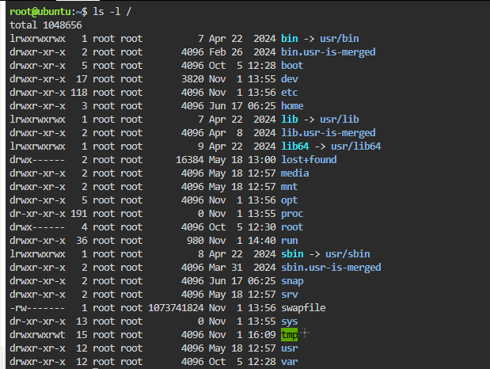
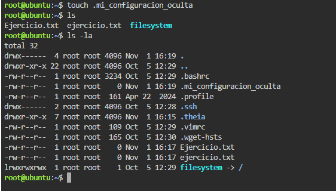
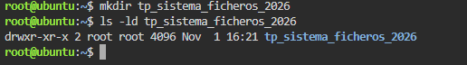
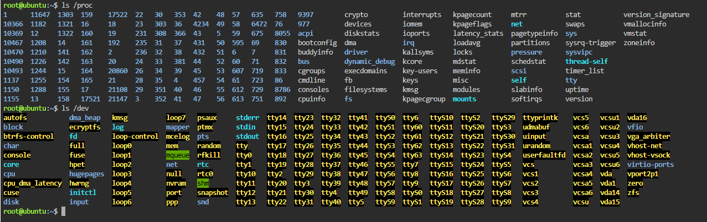
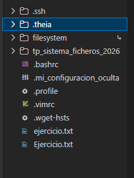

# TP: Sistema de Archivos en Linux

* **Materia:** Mantenimiento de Software
* **Estudiante:** Franco Lautaro Alvarez
* **Fecha de Entrega:** 2026
* **Profesor:** Artaza

---

## 1. Estructura del Árbol de Directorios

| Directorio | Función según la guía |
| :--- | :--- |
| `/etc` | Contiene los archivos de configuración de la mayoría de los programas. |
| `/home` | Contiene los archivos personales de los usuarios. |
| `/dev` | Contiene archivos simbólicos que representan partes del hardware (discos duros, memoria, etc.). |
| `/var` | Datos variables como archivos de log (registro de actividad), bases de datos, copias de seguridad y contenidos web. |

---

## 2. Sensibilidad a Mayúsculas y Minúsculas (Case Sensitivity)

*Respuesta:*  
En Linux y sistemas UNIX, el sistema de archivos es **case sensitive** (distingue estrictamente entre mayúsculas y minúsculas). Esto significa que cada nombre se almacena como una cadena binaria exacta; por ende, `Ejercicio.txt` y `ejercicio.txt` son considerados archivos totalmente diferentes y pueden convivir en el mismo directorio.  
En cambio, en Windows (que comúnmente utiliza sistemas de archivos NTFS o FAT bajo una interfaz insensible a mayúsculas y minúsculas), ambos nombres apuntan a una misma referencia y el sistema operativo no permite crear o mantener dos archivos con el mismo nombre y diferente combinación de mayúsculas en una misma carpeta para prevenir confusiones al usuario.

---

## 3. Visualización y Gestión de Archivos Ocultos

*Respuesta:*  
La utilidad de los archivos y carpetas ocultos (cuyo nombre comienza con un punto `.`) es almacenar información de inicialización, preferencias personales de usuario y configuraciones propias de programas o del sistema operativo. De esta manera, el espacio de trabajo de los usuarios permanece limpio y despejado a la hora de listar directorios con comandos básicos como `ls`, protegiendo además estos archivos críticos de modificaciones o eliminaciones accidentales en el uso diario.

---

## 4. Buenas Prácticas en Nombres de Archivos

*Respuesta:*  
* **`tp_sistema_ficheros_2026` cumple con las recomendaciones** porque utiliza exclusivamente caracteres recomendados: letras en minúscula (`a-z`), números (`0-9`) y guiones bajos (`_`) en reemplazo de espacios en blanco. No utiliza caracteres especiales, signos de puntuación extraños ni acentos.
* **`TP Sistema de Ficheros (Año 2026)!.doc` no cumple** debido a las siguientes malas prácticas detalladas en la guía:
  1. **Espacios en blanco:** La guía señala explícitamente que nunca se debe nombrar un fichero con espacios, ya que genera problemas en la interpretación de argumentos en la terminal y scripts.
  2. **Caracteres especiales y de puntuación:** Emplea paréntesis `(` `)` y el signo de exclamación `!`, los cuales son interpretados por shells de Linux como caracteres de control o operadores especiales.
  3. **Letra "ñ" y acentos:** No son recomendados en sistemas UNIX/Linux debido a discrepancias históricas y problemas de codificación (*encoding*).
  4. **Extensión innecesaria y mayúsculas mezcladas:** Asigna una extensión `.doc` a un directorio, lo cual desorienta sobre el contenido del recurso.

---

## 5. Exploración de Dispositivos y Procesos

*Respuesta:*  
El directorio `/proc` es un pseudo-sistema de archivos virtual generado dinámicamente en memoria por el kernel de Linux (no ocupa espacio en el disco físico). Su función es almacenar **información temporal y en tiempo real sobre los procesos en ejecución**, así como el estado interno del kernel y las métricas de hardware del sistema.

---

## Evidencia Adicional
Vista general de la estructura generada en el entorno:

