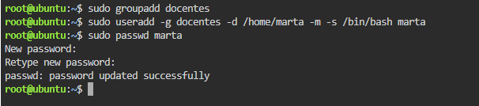
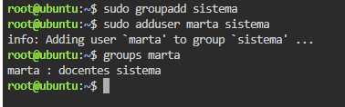
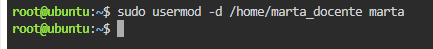
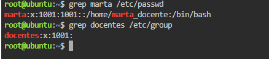
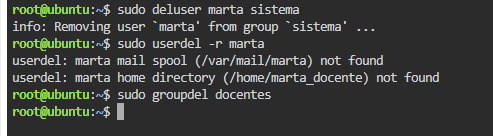

# TP: Administración de Usuarios y Grupos en Linux

* **Materia:** Mantenimiento de Software
* **Estudiante:** Franco Lautaro Alvarez
* **Fecha de Entrega:** 2026
* **Profesor:** Artaza

---

## 1. Creación de Grupos y Usuarios


* **Explicación del parámetro `-m`:**  
La opción `-m` indica al comando `useradd` que debe **crear automáticamente la carpeta personal (*home*) del usuario** (generalmente en `/home/nombre-usuario`), copiando además los archivos de configuración base desde `/etc/skel`.  
Si se omite el parámetro `-m`, el sistema registra el usuario en `/etc/passwd` pero **no crea su directorio personal en el disco**, por lo que el administrador debería crearlo manualmente y asignarle los permisos necesarios; de lo contrario, el usuario no contará con una carpeta propia al iniciar sesión.

---

## 2. Gestión de Grupos Secundarios


* **Comando para quitar usuario de un grupo:**  
El comando específico según la guía teórica es:
```bash
sudo deluser marta sistema
```
*(También se puede utilizar la alternativa `sudo gpasswd -d marta sistema`).*

---

## 3. Modificación de Usuarios


* **Diferencia entre `useradd` y `usermod`:**  
La diferencia fundamental radica en el ciclo de vida del usuario:
  * **`useradd`:** Se utiliza para **dar de alta y crear una cuenta de usuario nueva desde cero**, configurando sus valores iniciales (UID, grupo primario, directorio home, shell).
  * **`usermod`:** Se emplea para **modificar o actualizar parámetros de un usuario preexistente** ya registrado en el sistema (por ejemplo, cambiar su ruta de directorio home, su grupo principal o secundarios, o su shell).

---

## 4. Ficheros de Configuración


| Fichero | Contenido / Función |
| :--- | :--- |
| `/etc/passwd` | Almacena los datos principales de las cuentas de usuario del sistema (nombre de usuario, identificador UID, GID del grupo primario, directorio personal *home* e intérprete de comandos *shell*). |
| `/etc/group` | Contiene la información sobre los grupos de usuarios del sistema (nombre del grupo, GID y la lista de usuarios secundarios miembros de cada grupo). |
| `/etc/shadow` | Guarda las contraseñas de los usuarios de forma encriptada (con acceso exclusivo para root por seguridad), además de los parámetros de caducidad, validez y cambio periódico de contraseñas. |

---

## 5. Eliminación de Usuarios y Grupos


* **Uso del parámetro `-r` en `userdel`:**  
La opción `-r` (*remove*) fuerza la eliminación completa de los datos del usuario, borrando no solo la cuenta del sistema sino también **su directorio personal (*home*) y su buzón de correo**, evitando dejar archivos huérfanos en el disco.
* **Condición para borrar un grupo con `groupdel`:**  
Para poder eliminar un grupo con `groupdel`, es requisito indispensable que **ningún usuario del sistema lo tenga asignado como su grupo primario**. Si un usuario todavía tiene dicho grupo como principal, el sistema rechazará la eliminación para preservar la coherencia de permisos en el sistema de archivos.
